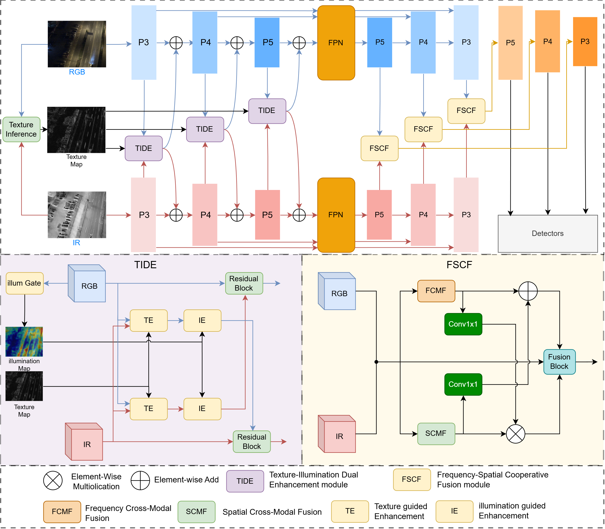

# TIFS-Net

> **TIFS-Net: Texture-Illumination Enhancement and Frequency-Spatial Fusion Network for Vehicle Detection in Aerial Imagery**
>
> Wei Wang, Chaofeng Li
> Institute of Logistics Science and Engineering, Shanghai Maritime University

[](https://www.python.org/)
[](https://pytorch.org/)
[](LICENSE)

This repository provides the official PyTorch implementation of **TIFS-Net**, an RGB-Infrared (RGB-IR) vehicle detection network for aerial/remote-sensing imagery. TIFS-Net is built on a dual-stream YOLOv8s backbone and introduces two collaborative modules to progressively enhance and fuse cross-modal features:

- **TIDE** (Texture-Illumination Dual Enhancement) — enhances unimodal features and suppresses redundant information under complex illumination.
- **FSCF** (Frequency-Spatial Collaborative Fusion) — jointly models global frequency-domain dependencies and local spatial alignment for deep cross-modal fusion.

## Table of Contents

- [Introduction](#introduction)
- [Overview](#overview)
- [Method](#method)
- [Results](#results)
- [Installation](#installation)
- [Datasets](#datasets)
- [Training](#training)
- [Evaluation](#evaluation)
- [Acknowledgement](#acknowledgement)
- [License](#license)

## Introduction

Vehicle detection from aerial (UAV) perspectives benefits from fusing visible (RGB) and infrared (IR) modalities. RGB images provide rich texture, color, and edge details, while IR images are robust to low-light, smoky, and poor-weather conditions. However, RGB-IR detection still faces three main challenges:

1. **Information redundancy** during cross-modal fusion;
2. **Severe illumination variations** that make the reliability of each modality change dynamically;
3. **Spatial misalignment** between the two modalities caused by sensor mounting errors and platform vibration.

TIFS-Net addresses these issues with texture/illumination-aware enhancement and frequency/spatial cooperative fusion, achieving state-of-the-art accuracy while remaining computationally efficient.

## Overview



TIFS-Net employs two parallel modality-specific branches to extract multi-scale RGB and IR features. The **TIDE** module is embedded at backbone stages **P3, P4, and P5** for adaptive cross-modal exchange, and the **FSCF** module performs deep fusion in the neck by jointly modeling frequency-domain and spatial-domain information.

## Method

### 1. Texture-Illumination Dual Enhancement (TIDE)

The TIDE module (paper Sec. 3.2) consists of two complementary mechanisms:

- **Texture-guided Enhancement (TE)** — builds a cross-modal shared texture prior from the co-occurrence of bimodal gradients, adaptively re-weights features so that texture/edge regions are enhanced while redundant edges are suppressed. A Sobel-based edge-sensitive branch refines the response to small-scale edges.
- **Illumination-guided Enhancement (IE)** — generates a pixel-level illumination-aware map from RGB features and dynamically adjusts the contribution/weight of each modality. In low-light regions, enhanced IR features compensate RGB; in high-brightness regions, enhanced RGB features assist IR.

A Residual Block finalizes the enhancement and feeds the enhanced features back into the backbone.

### 2. Frequency-Spatial Collaborative Fusion (FSCF)

The FSCF module (paper Sec. 3.3) consists of two parallel branches plus residual reconstruction:

- **Frequency-domain Cross-modal Fusion (FCMF)**
  - *Adaptive Frequency Fusion (AFF)*: fuses RGB and IR spectra directly in the complex (amplitude + phase) domain via a lightweight position-wise weight map.
  - *Spectral Cross-Attention (SCA)*: captures global long-range dependencies with linear complexity, using LRN pre-processing and a learnable frequency-domain positional encoding.
- **Spatial-domain Cross-modal Fusion (SCMF)**
  - An offset predictor explicitly warps the IR feature into the RGB coordinate frame.
  - Three-axis (**height × width × channel**) cross-modal alignment calibrates spatial and semantic discrepancies.
- **Residual Reconstruction**: frequency-domain and spatial-domain features are bidirectionally refined and fused, with a modality-preservation branch retaining the original modal information.

## Results

### Dataset 1: DroneVehicle

| Detector      | Car   | Bus   | Truck | Freight_car | Van   | mAP50 |
|---------------|-------|-------|-------|-------------|-------|-------|
| AR-CNN        | 90.10 | 89.40 | 64.80 | 62.10       | 51.50 | 71.60 |
| LF-MDet       | 82.20 | 86.60 | 73.60 | 59.60       | 57.00 | 71.80 |
| C²Former      | 90.20 | 89.90 | 68.30 | 64.40       | 58.50 | 74.20 |
| CAGTDet       | 90.82 | 90.46 | 69.65 | 66.28       | 55.62 | 74.57 |
| CLGNet        | -     | -     | -     | -           | -     | 75.10 |
| CALNet        | 90.30 | 89.11 | 76.15 | 62.97       | 58.46 | 75.39 |
| SLBAF-Net     | 90.20 | 89.90 | 72.00 | 68.60       | 59.90 | 76.10 |
| LCAFNet       | 90.30 | 89.70 | 69.70 | 67.90       | 63.40 | 76.20 |
| OAFA          | 90.30 | 90.30 | 76.80 | 73.30       | 66.00 | 79.40 |
| MGMF          | 91.40 | 91.10 | 70.10 | 78.50       | 69.40 | 80.30 |
| DB-CMCNet     | 97.60 | 95.20 | 80.80 | 68.60       | 63.20 | 81.10 |
| RGFNet        | 98.40 | 95.80 | 81.10 | 68.70       | 63.00 | 81.40 |
| SGFNet        | -     | -     | -     | -           | -     | 82.00 |
| ADMPF         | 97.94 | 95.93 | 82.28 | 69.34       | 64.77 | 82.05 |
| **TIFS-Net (ours)** | **98.60** | **96.30** | **83.00** | **76.10** | **64.30** | **83.70** |

### Dataset 2: VEDAI

| Detector        | Car   | Pickup | Truck | Camping | Boat  | Tractor | Van   | Other | mAP50 |
|-----------------|-------|--------|-------|---------|-------|---------|-------|-------|-------|
| YOLOrs          | 84.15 | 78.27  | 52.60 | 68.81   | 21.47 | 67.88   | 57.91 | 46.75 | 59.73 |
| SuperYOLO       | 91.13 | 85.66  | 70.18 | 79.30   | 60.24 | 80.41   | 76.50 | 57.33 | 75.09 |
| DB-CMCNet       | 91.00 | 87.50  | 80.30 | 58.70   | 64.10 | 84.10   | 83.20 | 56.10 | 75.60 |
| YOLOFusion      | 91.70 | 85.90  | 78.10 | 78.90   | 71.70 | 71.90   | 75.20 | 54.70 | 75.90 |
| ICAFusion       | -     | -      | -     | -       | -     | -       | -     | -     | 76.62 |
| MF-YOLO         | 92.03 | 86.61  | 72.58 | 78.19   | 64.64 | 82.88   | 78.66 | 57.36 | 76.62 |
| CLGNet          | -     | -      | -     | -       | -     | -       | -     | -     | 80.20 |
| **TIFS-Net (ours)** | **92.50** | **86.70**  | **88.50** | **86.80**   | **69.00** | **81.50**   | **89.10** | **66.00** | **82.50** |

### Ablation Study (DroneVehicle)

| Method                | Baseline | TIDE | FSCF | mAP50 | FLOPs (G) | Params (M) |
|-----------------------|----------|------|------|-------|-----------|------------|
| Baseline              | ✓        |      |      | 80.70 | 42.224    | 16.50      |
| Baseline + TIDE       | ✓        | ✓    |      | 81.90 | 47.898    | 19.83      |
| Baseline + FSCF       | ✓        |      | ✓    | 82.80 | 55.856    | 20.99      |
| **TIFS-Net (ours)**   | ✓        | ✓    | ✓    | **83.70** | **61.531** | 25.24      |

### Component Ablation within FSCF

| Method                    | TIDE | FCMF | SCMF | mAP50 |
|---------------------------|------|------|------|-------|
| TIFS-Net (only FCMF)      | ✓    | ✓    |      | 82.70 |
| TIFS-Net (only SCMF)      | ✓    |      | ✓    | 83.10 |
| **TIFS-Net (ours)**       | ✓    | ✓    | ✓    | **83.70** |

### Efficiency Comparison

| Detector   | Params (M) | FLOPs (G) | mAP50 | Type       |
|------------|-----------|-----------|-------|------------|
| LF-MDet    | 38.70     | 77.70     | 71.80 | One-stage  |
| C²Former   | 100.80    | 89.90     | 74.20 | Two-stage  |
| SGFNet     | 45.20     | 128.50    | 82.00 | One-stage  |
| ADMPF      | 31.80     | 68.80     | 82.05 | One-stage  |
| **TIFS-Net (ours)** | **25.24** | **61.53** | **83.70** | **One-stage** |

## Installation

```bash
# 1. Create a conda environment
conda create -n tifs python=3.8 -y
conda activate tifs

# 2. Install PyTorch (choose the command matching your CUDA version)
# CUDA 11.8
pip install torch torchvision --index-url https://download.pytorch.org/whl/cu118
# CUDA 12.1
pip install torch torchvision --index-url https://download.pytorch.org/whl/cu121

# 3. Install dependencies
pip install -r requirements.txt
```

The experiments in the paper were conducted on an **NVIDIA GeForce RTX 4090 (24 GB)** GPU using **PyTorch**.

## Datasets

### DroneVehicle

- **Link**: https://github.com/VisDrone/DroneVehicle
- **Description**: RGB-Infrared image pairs captured from a drone perspective over urban roads, parking lots, and residential areas. It contains 17,990 training pairs, 1,469 validation pairs, and 8,980 test pairs, with bird's-eye view angles of 0°, 15°, 30°, and 45°.
- **Classes**: `car`, `bus`, `truck`, `van`, `freight car`.

### VEDAI

- **Link**: https://downloads.greyc.fr/vedai/
- **Description**: Multispectral aerial dataset with more than 1,200 strictly aligned RGB-Infrared image pairs, covering challenging lighting and occlusion conditions.
- **Classes**: `car`, `pickup`, `truck`, `camping car`, `boat`, `tractor`, `van`, `other`.

Please follow the dataset licenses and cite the original papers when using them.

## Training

TIFS-Net is based on a dual-branch **YOLOv8s** framework. Training settings follow the paper:

| Setting              | DroneVehicle | VEDAI        |
|----------------------|--------------|--------------|
| Input size           | 640 × 640    | 1024 × 1024  |
| Optimizer            | SGD (momentum 0.937) | SGD (momentum 0.937) |
| Learning rate        | 0.01 → 0.0001 (cosine decay) | 0.01 → 0.0001 (cosine decay) |
| Epochs               | 100          | 100          |
| NMS IoU threshold    | 0.5          | 0.5          |

*Detailed training and evaluation commands will be added once the code is organized.*

## Evaluation

Results are reported in terms of **mAP50** (AP at IoU threshold 0.5).

## Acknowledgement

The authors would like to thank the creators of the publicly available DroneVehicle and VEDAI datasets, as well as the developers of the open-source algorithms used in this work. This work was supported by the National Natural Science Foundation of China (No. 62572293).

## License

This project is released under the [MIT License](LICENSE). Please refer to the respective licenses of the datasets before use.
